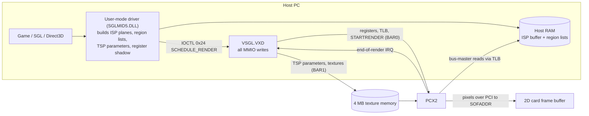

# PowerVR PCX1/PCX2 Driver–Hardware Interface Reference

Last updated 2026-10-19 · Zvi Rosen ([z2k-retro](https://github.com/z2k-retro)) · see [the appendices](README.md) for formats, tables and procedures

Every 4.x Windows driver for PCX1 and PCX2 boards drives the chip identically. At device start the VxD writes a fixed register table plus two lookup tables. For each frame it copies about ten shadow registers, the page table and the TSP parameters to the card, pulses soft reset and writes STARTRENDER. Completion is an interrupt that the driver acknowledges just by reading INTSTATUS. The driver-side facts come from Imagination's public Series 1 source release and static analysis of the 4.1.1.5 developer VxD, cross-checked against 24 shipped VxDs (Matrox, NEC, Melco, VideoLogic, reference). The hardware facts in the sections from "Measured on the Matrox m3D" onward were measured on a real m3D (PCX2 rev 1).

## At a glance



User-mode code builds the scene in host RAM and a register shadow. The VxD makes every MMIO write, copies TSP parameters into texture memory, and starts the render; the chip then pulls the scene over PCI and writes pixels straight into the 2D card.

## PCI identity and memory windows

The card is a bus-mastering PCI device with two memory BARs: registers in BAR0 and 4 MB of texture memory in BAR1. On a PCX2 the driver also reads register 1 to pick the silicon revision; any value other than 1 or 3 leaves the board uninitialized.

| Item | Value | Where it is established |
| --- | --- | --- |
| Vendor ID | 0x1033 (NEC) | INF files, `pcx/brdsetup.h` |
| PCX1 device ID | 0x002A, chip NEC µPD62010GD001, driver type MIDAS4 (2) | `brdsetup.h`, SDK install guide |
| PCX2 device ID | 0x0046, chip NEC µPD62011GD001 | same |
| PCX2 revision | `REVISION` register = 1 → PCX2_002, MIDAS5 (3); = 3 → PCX2_003, MIDAS5_003 (4) | VxD PnP handler (`<<<` at 1000500a in the listing) |
| BAR0 | Register file, 64 KB, prefetchable, DWORD-indexed (register *n* at byte 4*n*); mapped as `LinearMemWindows[0]` | VxD ISR and render code |
| BAR1 | Texture memory window; TSP parameters are copied here each frame; the VxD sets a write-combining MTRR over it | `brdsetup.c` (`DestAddr[TSP]`), `texif.c`, VxD MTRR routine |
| IRQ | Config 0x3C interrupt line; one source used, end of render | VxD ISR |
| Latency timer | Driver writes 0x40 if BIOS left 0 (override: `Latency`) | `PVROSSetupPCILatency` |
| Cache line / MWI | PCX2 only: cache line size from `PCX2CacheLineSize` (default 0), Memory Write and Invalidate (command bit 4) enabled only when nonzero | `PVROSSetupPCICacheLine` |

The card renders straight into the 2D card's frame buffer over PCI: `SOFADDR` holds a physical address in the other card's aperture.

## Board initialization

This sequence runs once, from the VxD's Plug-and-Play `CONFIG_START` handler (`InitBoard` at 10006d00 in the developer listing). In the 3.0.x drivers the same tables were loaded from `SGLMID4.DLL` instead.

1. Map BAR0 and BAR1 and record them in the board's `BoardDataBlock`.
2. Pick the device type: PCX1 for device 0x002A; for 0x0046, read `REVISION` (1 → MIDAS5, 3 → MIDAS5_003; anything else leaves the board uninitialized).
3. PCX1 only: write the 512-DWORD `ReciprocalTable` to `DIVIDER_TABLE` (byte 0x800).
4. For each register 0x00 up to the last index (0x17 PCX1, 0x1E PCX2) whose table entry has flag bit 0, write its default ([Appendix A](appendix-a-registers.md), "Init").
5. Write the 128-DWORD `FogTable` to `FOG_TABLE` (byte 0x200).
6. Pulse `SOFTRESET`: write 1, write 0, busy-wait about 1000 iterations.
7. Program a spare CPU MTRR as write-combining over BAR1 (skipped when the CPU has none or `WriteCombining` is off).
8. Virtualize the IRQ through VPICD with the PCX ISR.

The user-mode driver separately sets the PCI latency timer and, on PCX2, the cache line size (PCI identity table). The DOS port (`dos32/`, `pcx/hwregs.c` `!WIN32` branch) performs steps 3–5 itself with the same values, so it can serve as a readable reference for this sequence.

## Per-frame render sequence

User-mode code never touches the hardware. It fills three buffers and a 32-DWORD register shadow, and the VxD performs every MMIO write in one burst just before the start strobe.

**User mode** (`pcx/hwregs.c` `HWStartRender`, `win32/system.c` `PVROSScheduleRender`):

1. Wait for the previous frame's end of render.
2. Get the target surface from the pre-render callback, then set `PACKMODE` (format and dither), `SOFADDR` (linear address at this point) and `LSTRIDE` in the shadow.
3. Fog, fog colour, camera, object offset, X clip, bilinear and fast fog are already in the shadow from scene setup.
4. Copy the shadow and the three buffers' fill positions into the `BUFFER_LIST`, then issue IOCTL 0x24 `SCHEDULE_RENDER` with `{LDEVICE*, BUFFER_LIST*}`.

**VxD** (`SchedulerDoRender` at 100072e3; if the board is busy the request is queued and started from the end-of-render handler):

1. For each buffer (ISP, TSP, region) whose `pBuffer` differs from its `DestAddr`, copy `uBufferPos` DWORDs across. In practice only the TSP buffer moves, into BAR1.
2. Write every register whose table flag has bit 1 from `BUFFER_LIST.Registers[]`. `SOFADDR` is first translated from linear to physical with `_CopyPageTable`.
3. Write `PAGE_CTRL` = (PhysAddresses[0] >> 24) | {0, 0x100, 0x300} for 4/8/16 KB pages.
4. Write the page table: `TLB[i]` = PhysAddresses[i] >> 12 for each slot used.
5. Pulse `SOFTRESET` (1, 0, busy-wait).
6. Write 0 to `STARTRENDER`.
7. Arm a timeout of `LDEVICE.RenderTimeout`; if it fires, the VxD pulses SOFTRESET and completes the frame as if it had ended normally.

Textures cannot be uploaded during a render. The SDK says texture writes wait until the hardware has finished, so an emulator can assume BAR1 is quiet while rendering.

## End of render

The chip raises one interrupt, end of render (INTSTATUS bit 1, enabled by INTMASK = 2). No driver ever writes INTSTATUS, so reading it must clear the condition, or reading must at least drop the IRQ line. That is a strong inference, not something the source states outright.

- **VxD ISR** (`PCX_ISR` at 10004600): reads `INTSTATUS`, then `INTMASK`. If the AND is zero it returns with carry set (the interrupt is not ours; chain). Otherwise it sets a status flag, optionally schedules a global event for an app callback, calls `SchedulerOnEndOfRender` and issues `VPICD_Phys_EOI`.
- **SchedulerOnEndOfRender**: cancels the timeout, sets `LDEVICE.RenderStatus` = 1 (EOR), decrements `RendersPending` and starts the next queued render, if any.
- **DOS port** (`dos32/isr.asm`): does the same two reads. Its real-mode handler temporarily relocates BAR0 to 0xB8000 just to perform them, commented "to acknowledge the interrupt".
- **Polling**: applications can also poll the status DWORD, which is volatile, with bit 0 = rendering ended (SGL Direct manual). The DOS build defaults to polling (`POLL_EOR`).

A second, older ISR (`IOPort_ISR` at 10004569) reads status through an I/O-port window and treats bit 1 as the TSP interrupt. It appears to belong to the earlier bridge-based boards and is not used for PCX1/PCX2.

## Memory model

The scene lives in three buffers. The chip bus-masters the ISP planes and region lists out of host RAM, while TSP parameters and textures sit in on-card memory behind BAR1.

| Buffer | Holds | Lives in | How the chip finds it | Source |
| --- | --- | --- | --- | --- |
| ISP (`PVR_PARAM_TYPE_ISP`) | Plane parameters for the visibility processor (default 512 KB) | Host RAM, scatter-gather (`CreateDMAScatterBuffer`) | TLB: entry *i* = page number of 4/8/16 KB slot *i*; PAGE_CTRL gives the page size | `win32/brdsetup.c` `DMASBToPCXTLB`, VxD |
| Region / object pointers (`PVR_PARAM_TYPE_REGION`) | Per-tile lists of object pointers (256 pages on Windows) | Host RAM. PCX1: one contiguous DMA block. PCX2: inside the TLB-mapped space | `OBJECT_OFFSET`: PCX1 = physical address; PCX2 = byte offset from ISP buffer start, OR 1 | `brdsetup.c` `PVROSAssignVirtualBuffers`, `brdsetup.h` `POINTERS_IN_TLB` |
| TSP (`PVR_PARAM_TYPE_TSP`) | Shading and texturing parameters per object | Built in locked host memory, copied by the VxD to BAR1 offset 0 before each render | `PREC_BASE` = 0; first usable index is 12 (PCX1) or 6 (PCX2) because low tags are reserved | `brdsetup.c`, `pcx/hwregs.c` |
| Textures | 16-bit texels, MIP chains | BAR1, uploaded between renders | Texture addresses inside the TSP parameters | `texapi.c` |

- **Texture memory addressing**: the upload code computes `BAR1 + (address >> 1)` DWORDs, with odd addresses in the low 16 bits and even ones in the high 16 bits. MIP levels use interleaved index patterns (`nIndex64For128` and similar in `texapi.c`), so textures are not stored as plain row-major bitmaps.
- **PCX1 vs PCX2 texture writes**: PCX1 does read-modify-write of those DWORDs; PCX2 builds never read texture memory back.
- **Capacity**: 4 MB fitted; the D3D guide says about 0.5 MB is reserved for PowerVR, leaving about 3.5 MB for textures.
- **Region pages**: the region buffer size is read from `system.ini` `[VSGL] Buffer1Size` (default 256 pages); the VxD also reads `Buffer2Size`, `MaxPCXBuffSize` and `LockToVSync`.

The formats inside these buffers (plane equations, region words, TSP words) are produced by `pkisp.c`, `pktsp.c` and `dregion.c`, and consumed by the C models in `simulat3/` (`hwsabren.c`/`hwsabsim.c` for the ISP, `texas.c` for the TSP). The simulator has both PCX1 and PCX2 paths (for example "PCX2 version. Floating point, linked lists, 4 word parameter").

## Fog

Fog is exponential and computed per pixel from depth. The 128-entry `FOG_TABLE` holds the mantissa of 2^−x, and `FOGAMOUNT` is a right-shift that sets density. The simulator (`simulat3/hwsabren.c`, `InitPowerTable` and `Fog`) computes the fog factor this way:

```c
index  = depth >> FOGAMOUNT;          // FOGAMOUNT = SGL u32FogDensity, 0-31
shift  = min(index >> 7, 9);
factor = FogTable[index & 0x7F] >> shift;   // 0..255
```

`FogTable[i]` = floor(256 × 2^(−i/128)), with entry 0 clamped to 255. That is exactly the 512-byte table in every 4.x VxD. Fog colour comes from `FOGCOL` (0x01000000 | RGB), set once per render; bit 24 is the fog enable, and with it clear nothing is fogged (measured on the m3D, 2026-10-18); objects opt in per polygon (`bFogOn`). The D3D HAL supports only `D3DFOG_EXP` table fog. PCX2's `FASTFOG` register (bit 8 enable, 8-bit value) is a separate mode, off by default and undocumented beyond the register setup.

## Rendering behaviour the SDK documents

The SDK (Series 1 developer pages, 2000-05-02) has no register-level material. Its programming guides do state hardware behaviour that an emulator has to reproduce:

| Area | Behaviour | SDK source |
| --- | --- | --- |
| Tiling | Screen is processed in 32×32-pixel regions; the driver bins objects per region; screen-edge clipping is free; Z clipping still needed to keep 1/w positive | SGL Programming Guide §4 |
| Depth | 32-bit depth from 1/w only (Z ignored); best range 0–1; one compare mode, LESSEQUAL; on-chip, no Z memory | SGL Guide §5, D3D Guide §3 |
| Background | A colour-fill of the dummy D3D Z buffer sets a background clipping plane | D3D Guide §3.2 |
| Primitives | Convex objects built from planes; quads and n-gons are cheaper than triangles; only the first triangle defines a polygon's plane, texture and shading | SGL Guide §5–6 |
| Texture formats | Hardware holds 555 (opaque) and 4444 (alpha in the top 4 bits); 8-bit 332 exists without MIP maps; maps are square, 32/64/128/256; mixing formats in one map is illegal | SGL Guide §3, TEXTURES.DOC, D3D Guide §4 |
| Filtering | One mode per frame (hardware limit); bilinear follows OpenGL texel centres, so edges wrap; adaptive bilinear blends between MIP levels (2 reads) instead of within a level (4 reads), with the top level always bilinear; U/V mirroring exists except for 256×256 | SGL Guide §2, §8 |
| Shading | Colour = vertex × texture + specular; flat or Gouraud; specular highlights only on flat-shaded surfaces; the first TSP ASIC can only flat-shade translucent objects | SGL Direct manual §1.5, §4 |
| Translucency | Per-pixel depth for both opaque and translucent; translucent objects are sorted into passes by software, and a pass is visible only through later passes; alpha is 4 bits (16 levels); vertex alpha is flat (first vertex or average) | SGL Guide §3 |
| Shadows and light volumes | Infinite convex volumes per region bounding box; mode fixed for the whole frame, and switching mid-scene locks the hardware | SGL Direct manual §4.3 |
| 2D background | PCX1 always writes complete tiles (no 2D/3D compositing). PCX2 can leave uncovered pixels untouched (`SGLTT_TRANSBACKGROUND`), but cannot blend translucency onto a 2D background, which implies it never reads the frame buffer | D3D Guide §5.3, SGL Direct manual |
| Output | Renders over PCI into the 2D card's frame buffer in 555, 565, 24- or 32-bit | sglddraw guide, `PACKMODE` |

## Measured on the Matrox m3D

The PCX2 (rev 1) has its fog and divider tables built in, and a 128-entry, 12-bit page table. Read with pcx2dump on 2026-10-17, before any driver ran.

- The fog table (0x080–0x0FF) and divider table (0x200–0x3FF) power up holding the driver's `FogTable` and `ReciprocalTable` exactly, and ignore writes. Both are ROM on PCX2, which is why the driver loads the divider table only on PCX1.
- The TLB has 128 entries (0x100–0x17F) of 12 bits; 0x180–0x1FF read 0. Entries power up with random values.
- With `PAGE_CTRL[7:0]` = address bits 31:24, every ISP page must sit in one 16 MB window of host memory.
- No option ROM and no PCI capabilities list.
- Texture memory: all 4 MB is present and independent (no mirroring). Two full pattern passes and the 8- and 16-bit partial writes all checked clean at the driver's memory timings (`TMEM_SETUP` 0x22212275, `TMEM_REFRESH` 0x480). Uncached throughput from the host was 25.4 MB/s writing and 3.5 MB/s reading.
- Divider-table reads are order-dependent. A sweep upward from 0x200 returns every entry correctly, and so does re-reading an entry already swept past. Reading 0x200 seems to reset this: afterwards, jumping ahead (0x203, 0x2C5, 0x3FF) returns 0 until the sweep reaches that entry again. The table may be generated entry by entry rather than stored. No driver reads this table, so the emulator returns the plain values.

| Register | Implemented bits | Notes |
| --- | --- | --- |
| 0x06 `FOGAMOUNT` | 0x0000001F | 5-bit shift |
| 0x07 `OBJECT_OFFSET` | 0xFFFFFFFD | bit 1 not stored; bit 0 is the driver's flag |
| 0x08 `PAGE_CTRL` | 0x000003FF | [7:0] address bits 31:24, [9:8] page size |
| 0x09, 0x17, 0x1A | none | not implemented, read 0 |
| 0x0A `ISP_BASE`, 0x0B `PREC_BASE` | 0x000FFFFF | 20 bits |
| 0x0E `FOGCOL` | 0x01FFFFFF | 24-bit colour plus bit 24 |
| 0x0F `CAMERA` | 0x000007FF | 11 bits |
| 0x10 `PACKMODE` | 0x000000FF | 8 bits |
| 0x12 `LSTRIDE` | 0x00001FFC | dword-aligned, up to 8188 bytes |
| 0x13 `SOFADDR` | 0xFFFFFFFC | full 32-bit dword-aligned address |
| 0x14 `XCLIP` | 0x13FF13FF | matches `HWSetXClip`: enables at bits 28 and 12, right at 25:16, left at 9:0 |
| 0x15 `ABORTADDR` | none | reads 0 when idle |
| 0x18 `IEEEFP` | 0x0000000F | 4 bits |
| 0x19 `BILINEAR` | 0x00000007 | 3 bits |
| 0x1D `FASTFOG` | 0x000001FF | 9 bits |

## Traced on the Matrox m3D

A VFIO trace under QEMU (2026-10-17) captured the retail 4.1.1 driver's start-up and its first frame (the SDK's SGLTri demo). Both match the driver code, so the emulator needed no protocol changes.

- **Start-up:** read `REVISION` (1), write 16 registers with the values in Board initialization, load the 128 fog entries, pulse `SOFTRESET`. No divider-table writes on PCX2.
- **Before the first frame:** write `GPPORT` = 0, read it back as 0xF616, write `GPPORT` = 0x80000000. Reads return the input pins, not the written value.
- **Per frame:** 192 bytes of TSP parameters at texture memory offset 0, then `FOGAMOUNT`, `OBJECT_OFFSET` (0x180001), `FOGCOL` (0x1000000), `CAMERA` (0x3FF), `PACKMODE` (0x13), `ARBMODE`, `LSTRIDE` (0x500), `SOFADDR`, `XCLIP` (0x12810000: right clip at 641), `BILINEAR` (3), `FASTFOG`, `PAGE_CTRL` (0x300), all 128 TLB entries (16 KB pages, a 2 MB buffer just below 16 MB), a `SOFTRESET` pulse, and 0 to `STARTRENDER`.
- **Textures:** about 400 KB uploaded as 32-bit writes, allocated from the top of each 2 MB half of texture memory.
- **Crash in the VM:** `SOFADDR` was 0x000A0D08, inside the legacy VGA window, so the card's pixel writes ran on into the VM's RAM above 1 MB and crashed Windows before the interrupt handler ran. The card did raise its interrupt.

## Replayed on the Matrox m3D

The end-of-render interrupt is level-triggered and cleared by reading `INTSTATUS`, which reads 0x7 after a frame. Measured 2026-10-17 by replaying the Windows SGLTri frame on the card through VFIO (pcx2replay), with the VM's memory dump mapped at its original addresses.

- **Render:** the 640×480 frame finished 7.6 ms after `STARTRENDER`. The card drew SGLTri's blue triangle (pixel 0x001F, RGB565) at the position the demo's source gives: apex (320, 140), base from (220, 273) to (420, 273).
- **Interrupt:** the line stays asserted until acknowledged. Unmasking without touching the card fires it again.
- **Acknowledge:** the first read of `INTSTATUS` returns 0x00000007 and the second returns 0; the line then stays quiet. Bits 0 and 2 are not named in any driver. In two of about 420 card renders so far (Tomb Raider, and Moto Racer at 512×384) the first read returned 0x6, with bit 0 clear; drivers only test bit 1.
- **Test vector:** the trace, the 16 MB memory image and the card's frame together make a complete real frame for checking the emulator.

## Rendering model

The emulator draws PCX2 frames with the SABRE (ISP) and TEXAS (TSP) software models from `Source/simulat3/` (MIT licence), and reproduces the m3D's SGLTri frame exactly: all 307,200 pixels (2026-10-18).

- **Tile list:** at `OBJECT_OFFSET` (bytes, bit 0 a flag). A region word has bit 30 set: x size bits 4:0 (32-pixel units, minus 1), y size bits 14:5 (lines, minus 1), x position bits 19:15 (32-pixel units), y position bits 29:20. Object words give the plane count in bits 28:19 and the plane offset in words in bits 18:0. Bit 31 marks the very last object; bit 29 is a link pointer.
- **Planes (PCX2):** 4 words: IEEE A, B, C, then instruction in bits 3:0 and TSP tag in bits 31:4. The depth at pixel (x, y) is A·x + B·y + C on a 40-bit adder; perpendicular planes (instructions 2, 4, 0xA, 0xC) are rescaled first.
- **Precision:** A and B keep 15 significant bits, truncated, as in the simulator's PackTo20Bit() but without its exponent limits. Perpendicular planes are scaled with the simulator's ApproxRecip() bit trick, not an exact reciprocal. With both, the renderer matches the m3D on every test frame (one pixel in 921,600 aside); an exact reciprocal leaves 25–42 edge pixels wrong per frame.
- **TSP parameters:** at texture-memory word tag × 2. Word 0 holds the control flags (texture 0x80000000, smooth shade 0x40000000, fog off 0x20000000, shadow 0x10000000, highlight 0x04000000) and red; word 1 holds green and blue, or the shading origin.
- **Textures:** pixel address p is in texture-memory word p >> 1, the even pixel in the high half. Bank B starts at pixel 0x100000 (2 MB). Maps are twiddled (Morton order).
- **BILINEAR[1:0]:** 0 bilinear, 1 adaptive bilinear, 3 linear mip-mapping (from `HWSetBilinearRegister`). Bit 2 turns SDRAM caching off. Adaptive (1), measured: bilinear on the two finest mip steps, blending between mip levels beyond that, as in mode 3.
- **PACKMODE[1:0]:** 0 = 32 bpp, 1 = 24 bpp, 2 = 565, 3 = 555; bit 4 enables a 4×4 ordered dither: offset D[y mod 4][x mod 4] = [[7,3,6,2],[1,5,0,4],[6,2,7,3],[0,4,1,5]] is added to each 8-bit channel before cutting to 5 bits (D/2 for 565 green), saturating. Exact on every pixel in 555 and 565.
- **Card session (2026-10-18):** 86Box frame dumps drawn on the m3D through VFIO (pcx2play). Output formats, all three filter modes and a changed `CAMERA` all match the renderer exactly. Render times: 12.7 ms for the SGL logo frame at 16 bpp, 14.6 ms at 24 bpp, 16.6 ms at 32 bpp.
- **Fog, checked on the card (2026-10-18, Ultim@te Race):** the fog table, `FOGAMOUNT` and `FOGCOL` behave exactly as modelled, at four settings including a changed fog colour. Shadow volumes are still unchecked: no captured game used them.
- **`PREC_BASE`:** set to 0x100, the card's output scrambles (olive background, striped textures) in a way no simple shift of the TSP parameter address reproduces. All drivers leave it at 0; the emulator ignores it.

## Behaviour found with game frames

Seven behaviours differ from the Imagination simulator or were missing from it; each was found by drawing 86Box frame dumps on the m3D and fixing the renderer until every pixel matched.

| Behaviour | What the m3D does | Found with |
| --- | --- | --- |
| Plane C range | C·scale is converted to the 32-bit fixed point with saturation. An edge plane with A = B = 0 scales to just above 1.0 and counts as inside; wrapping it to a large negative value blacked out whole regions. | Moto Racer demo |
| Edge test sign | An edge (perpendicular) plane classifies a pixel by the sign of the full 40-bit sum, so a value just below zero is outside. Depths for the other planes still round toward zero. | Shadows of the Empire |
| Masking plane | TSP address 2 (tag 1) is the masking plane. Where it is the visible surface the pixel is not written at all, so the frame buffer's old contents show through. The D3D driver uses it as its background (`PackTexasMask` in `pktsp.c`). | Shadows of the Empire |
| Mip chain offset | A mip-mapped texture's chain starts one pixel in: the 1×1 level is the second pixel of the first word, and every larger level follows it. The simulator's offsets are one pixel short. | Ultim@te Race |
| Fog enable | `FOGCOL` bit 24 turns fog on; with it clear no pixel is fogged, whatever the TSP flags say. | Ultim@te Race |
| Adaptive bilinear | `BILINEAR` = 1 filters bilinearly on the two finest mip steps (the simulator's level estimate below 2) and blends between mip levels beyond that. | Ultim@te Race |
| Right clip | With `XCLIP` bit 28 set, columns from bits 25:16 onward are not written, so with the drivers' width + 1 the chip writes one column past the scene. The renderer had stopped one column earlier. | MDK |

## Games compared on the m3D

Every game captured so far matches the card to within 13 pixels of 307,200 per frame, and most frames match exactly. Counts are differing pixels per 640×480 frame after the fixes above.

| Software | API | Frames compared | Differing pixels | Notes |
| --- | --- | --- | --- | --- |
| SGLTri (SDK demo) | SGL | 1, traced from a VM | 0 | First replay of a real driver frame |
| SGL logo demo | SGL | 3 + 13 register variants | 0, 1, 0 | All output formats, dither, filters, `CAMERA` |
| Moto Racer demo | Direct3D | 6 at 640×480; 3 + 15 register variants each at 512×384, 640×400, 16:9 and split screen | 0 to 13; 0 at 512×384; 0 to 2 at 640×400; 0 at 16:9; 0 to 7 split screen | 13 in one frame, distant scenery. 512×384 is 16×12 whole tiles (`XCLIP` right limit 513); 640×400 ends in a half-height row of tiles, and the 16:9 mode draws 640×360, ending in a row only 8 lines tall; both match. The few differing pixels are single pixels on polygon edges mid-screen. Split screen draws each player's view as its own 320×400 frame (`LSTRIDE` 640, `XCLIP` right limit 321) into two buffers in turn, which the game then places side by side |
| Shadows of the Empire | Direct3D | 6 in game, 3 menu | 0 to 1 in game, 5 menu | Menu seams and dim text are on the card too. The probe droid's pale legs (Hoth) match exactly: they are drawn as an ordinary opaque 16-bit (555) texture, with no alpha or translucency, so the pale colour is in the texture as the driver converted it |
| Ultim@te Race | Direct3D | 3 + 16 register variants | 0 | First game with fog and mip-maps |
| Quake timedemo | PowerVR port | session run | 0 | Reported by Zvi, 2026-10-18 |
| Unreal castle flyby | Direct3D | 3 | 2, 0, 1 |  |
| GLQuake (timedemo 1 and play) | PowerVR minigl | 15 in 5 sessions + 15 register variants each | 0 to 1 | Busiest scenes so far: up to about 580,000 shaded pixels per frame from lightmap passes; the card takes 25–45 ms |
| Quake II | PowerVR port (the game's PowerVR option) | 3 + 15 register variants | 1 | One pixel one shade brighter, a rounding difference; the card takes about 37 ms per frame |
| MechWarrior 2 (PowerVR patch) | SGL | 3 + 15 register variants | 0 | Windows 95 version; fog on (`FOGAMOUNT` 5) and `CAMERA` 0x13F |
| MoonRacer | SGL | 9 + 15 register variants | 0 | First game with shadow and light volumes throughout; `CAMERA` 0x1E0 |
| Winter Race 3D demo | SGL | 3 | 0 | Gouraud and flat-highlight shading, translucency |
| Tomb Raider demo (DOS) | SGL, DOS driver | 3 + 15 register variants | 0 to 3 | Adaptive bilinear with mip-maps and fog; see below |
| Flight Unlimited (Compaq OEM) | SGL | 3 + 15 register variants | 0 to 1 | First game seen with mirrored textures: every texture is mirrored in u, mip-mapped, with `BILINEAR` = 3 and fog. The adaptive-bilinear variant, mirrored u with bilinear filtering, is exact too |
| Sub Culture | not recorded | 3 | 0 to 1 | Dark blue fog (`FOGAMOUNT` 16); right clip at 643 with tiles to x = 671 |
| Wipeout XL | not recorded | 3 | 0 to 1 | Drawn without dither (`PACKMODE` 0x02) |
| PureVex | SGL | 3 + 15 register variants | 0 | Sets `BILINEAR` = 1 (adaptive) itself, with fog |
| MDK | Direct3D | 3 + 15 register variants | 0 | 600-pixel 3D view beside the 2D panel; found the right-clip rule |

Tomb Raider and the Hexen II demo looked correct in 86Box but were not compared on the card. Terracide shows minor flicker, not yet captured. POD crashes on launch.

### The DOS driver

PowerVR's DOS SGL driver, as used by the Tomb Raider demo, differs from the Windows drivers in two ways seen in its frames: it writes the 128 TLB entries once at start-up rather than before every frame, and it alternates `OBJECT_OFFSET` between 0x180001 and 0x100001 from frame to frame (double-buffered region data). The chip handles both the same way; 86Box dumps before pcx-v0.2 missed the scene for the first reason (Appendix G).

### Edited frames

For features no captured game uses, real frames were edited (texture settings changed in the TSP words, texture data untouched) and drawn on the card:

| Feature | Result |
| --- | --- |
| 8-bit (332) textures, set up as SGL creates them | Exact, with every filter mode, output format and fog setting |
| Mirrored textures, bilinear off | Exact in u, v and both; also exact in a real game (Flight Unlimited, mirrored in u) |
| Mirrored textures, between mip levels (`BILINEAR` = 3) | Exact |
| Mirrored in u, bilinear filtering | Exact (10 pixels): the filter weight is inverted along with the coordinate. Also exact in Flight Unlimited with `BILINEAR` = 1 |
| Mirrored in v, bilinear filtering | Not yet matched; the u rule does not carry over |
| A texture without mip-maps whose mip level field is non-zero | Differs where the level is 2 or more. No driver writes this combination |
| An 8-bit texture with the 4444 flag set | The card draws white. No driver writes this combination |

## Open questions for emulation

- [x] What `REVISION` on the Matrox m3D: 1 (PCX2_002), read from the card 2026-10-17.
- [x] Answered 2026-10-17 (reading clears it; it reads 0x7): does reading `INTSTATUS` clear it, or does the next `SOFTRESET` clear it? Both drivers only read it; check on hardware or in a trace.
- [x] Meaning of `PAGE_CTRL` bits 0–7 (the ISP buffer's top address byte): answered: yes. The PCX2 keeps only 12 bits per TLB entry, so all pages share address bits 31:24 (measured 2026-10-17).
- [ ] Unused or unknown registers: `ID` (answered: 0x10330046), 0x09, 0x17, 0x1A (answered: not implemented), `ABORTADDR`, `GPPORT`, `ARBMODE` bits, `TMEM_SETUP` and `CLKSELECT` fields.
- [ ] How the ISP uses the PCX1 divider table entries (the mask half of each pair); `simulat3/hwsabsim.c` may show it.
- [ ] PCX2 `FASTFOG`: what the 8-bit value does.
- [x] Answered 2026-10-18 (see Rendering model): exact plane, region and TSP word formats, from `pkisp.c`, `pktsp.c`, `dregion.c` and the `simulat3/` models.

## Sources

- [PowerVR-Series1 source release](https://github.com/powervr-graphics/PowerVR-Series1) (Imagination Technologies, MIT licence), in particular [pcx/hwregs.h](https://github.com/powervr-graphics/PowerVR-Series1/blob/main/Source/pcx/hwregs.h), [pcx/hwregs.c](https://github.com/powervr-graphics/PowerVR-Series1/blob/main/Source/pcx/hwregs.c), [pcx/rectable.h](https://github.com/powervr-graphics/PowerVR-Series1/blob/main/Source/pcx/rectable.h), [win32/fogtable.h](https://github.com/powervr-graphics/PowerVR-Series1/blob/main/Source/win32/fogtable.h), [win32/brdsetup.c](https://github.com/powervr-graphics/PowerVR-Series1/blob/main/Source/win32/brdsetup.c), [win32/system.c](https://github.com/powervr-graphics/PowerVR-Series1/blob/main/Source/win32/system.c), [pvrosapi.h](https://github.com/powervr-graphics/PowerVR-Series1/blob/main/Source/pvrosapi.h), [dos32/](https://github.com/powervr-graphics/PowerVR-Series1/tree/main/Source/dos32), [simulat3/](https://github.com/powervr-graphics/PowerVR-Series1/tree/main/Source/simulat3)
- PowerVR Series 1 developer SDK web pages (Series1_2000-05-02): `411c3deb.zip` (4.1.1.5 developer build, `vsgl.dev`), *SGL Programming Guide* 2.0, *D3D Programming Guide for PowerVR* 1.0, *PowerSGL Direct* reference manual, `TEXTURES.DOC`, `sglddraw` guide, `pvrinst.pdf`, build notes `410c3.rtf` and `411c3.rtf`
- Vogons PowerVR driver collection: 24 `VSGL.VXD` files (Matrox m3D 4.0.1/4.1.1, NEC, Melco, VideoLogic, reference 3.0.1–4.1.2), used for cross-version comparison
- Annotated disassembly of `vsgl.dev` and the retail Matrox m3D 4.1.1 `vsgl.vxd`, produced with `vxdtool.py`; listing addresses cited above use that tool's synthetic numbering
